# KREEDA — Court Booking, Events & Facility Management for the PES Sports Complex

DBMS Experiential Learning, Level 3 · PES University

| Member | SRN |
|---|---|
| Dhanush Shankar Reddy | PES1UG24AM083 |
| Dhanush S S | PES1UG24AM082 |

## The problem

Courts at the PES sports complex are claimed informally at the counter. The same slot gets promised twice, courts sit empty when the person who claimed them doesn't show up, tournaments go on notice boards with no link to the courts they occupy, and damaged nets are reported by word of mouth and forgotten. Nothing is recorded.

KREEDA moves all of this online, and puts the rules inside the database so they hold even when two people click "Book" at the same second.

## What it does

| Role | Can do |
|---|---|
| **Member** | See live availability, book and cancel slots, join waiting lists, post "looking for a game" and get matched by meaning, register for events, raise complaints (with automatic detection of similar existing complaints) |
| **Staff** | Check members in or mark no-shows, issue and return locker keys and equipment (late fines are calculated automatically), work through the complaints queue |
| **Admin** | Reports dashboard with charts, create events that block courts (clashing bookings are cancelled and members notified), maintenance blocks, court timings and booking rules |

## Screenshots

### Login

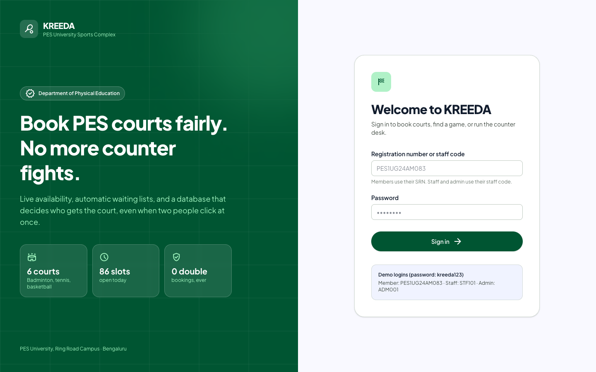

### Member

**Book a Court**: live schedule for the next 7 days. Click an open slot to book it, or a booked one to join its waiting list. The fair-use limit is shown on the right.

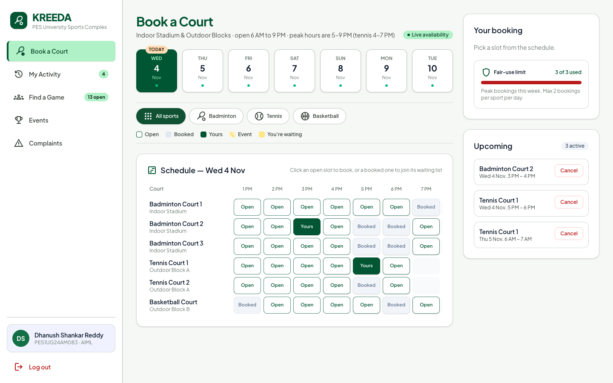

**Find a Game**: describe the game you want in your own words. Posts are matched by meaning (Qdrant), not keywords.

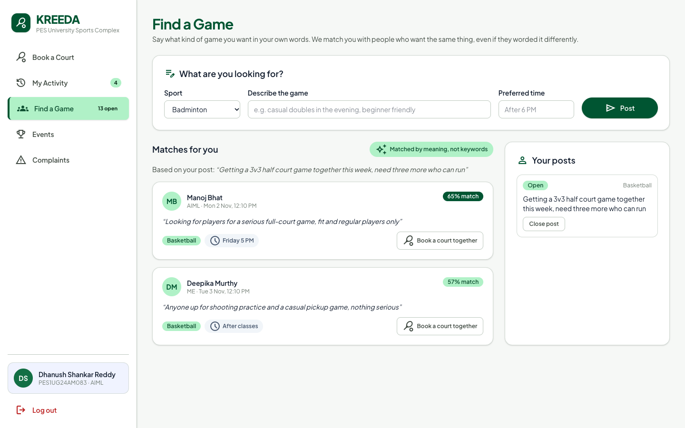

<details>
<summary>More member pages: Events, My Activity, Complaints</summary>

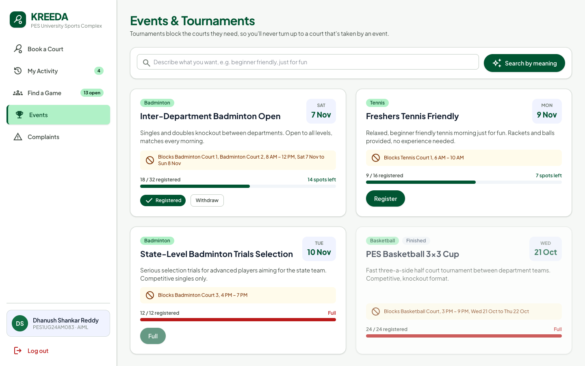

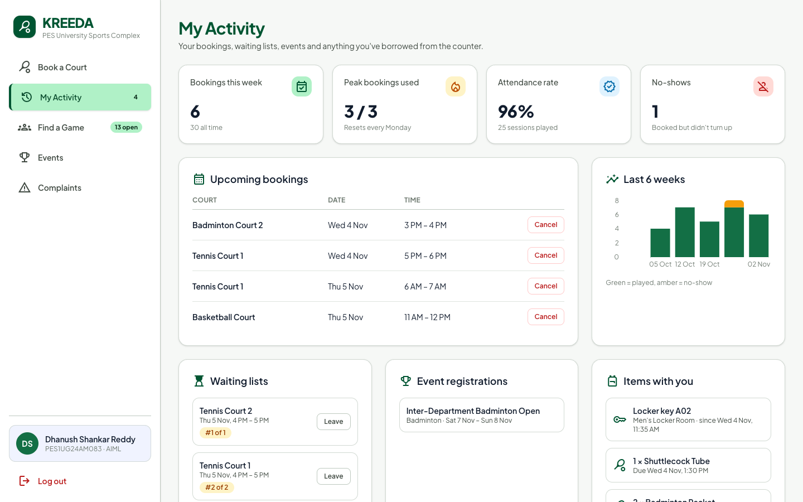

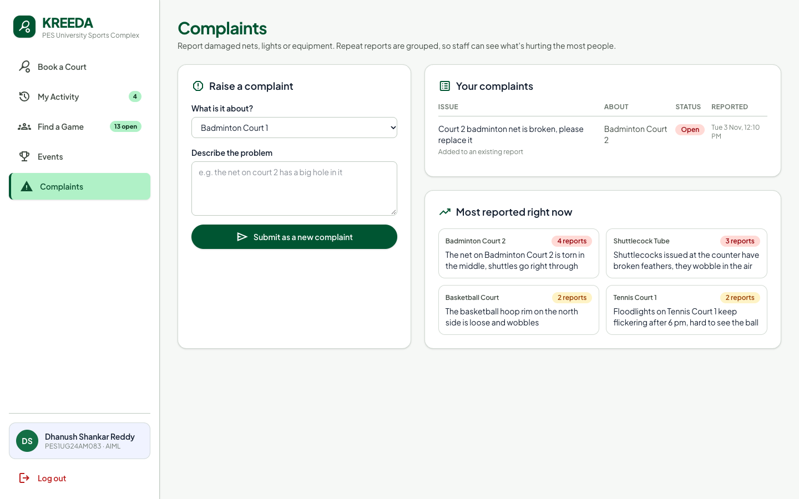

</details>

### Staff

**Counter Desk**: today's bookings. Check members in, or mark missed bookings as no-shows.

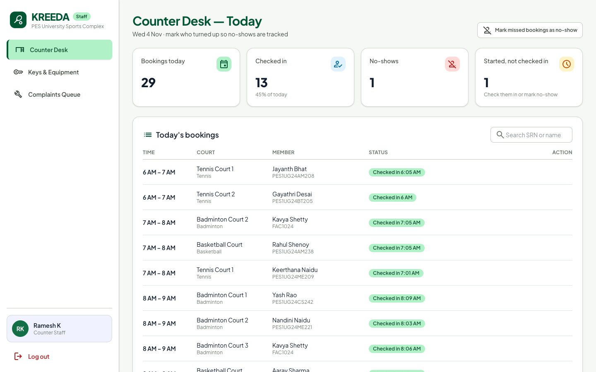

<details>
<summary>More staff pages: Keys & Equipment, Complaints Queue</summary>

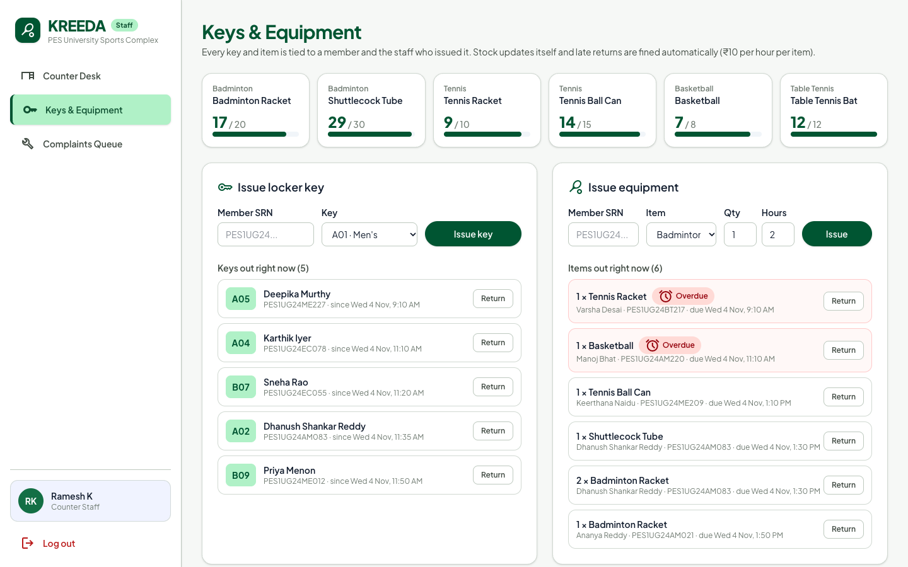

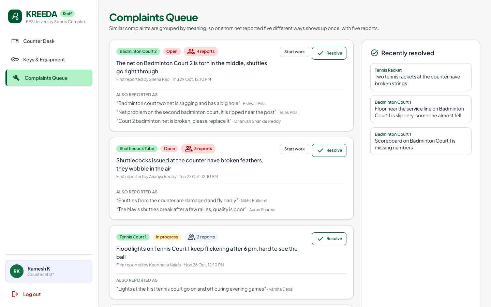

</details>

### Admin

**Reports**: every chart is a SQL view from `db/reports.sql`.

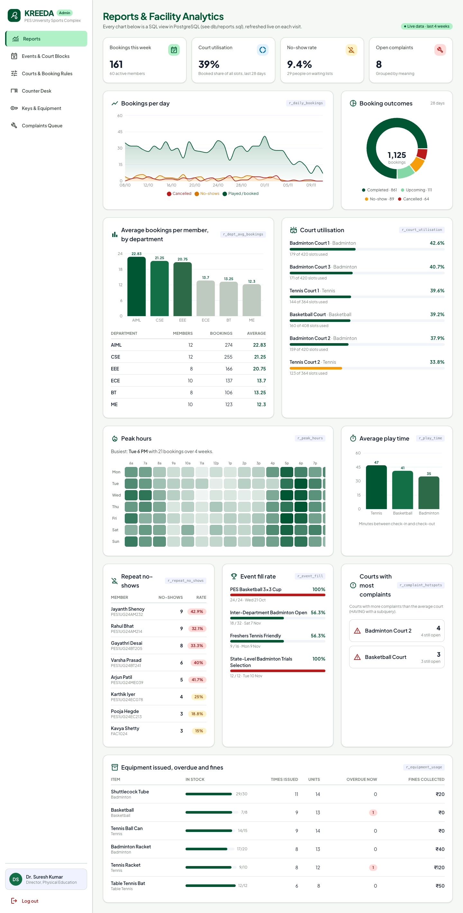

**Events & Court Blocks**: creating an event blocks its courts in one transaction; clashing bookings are cancelled by a trigger.

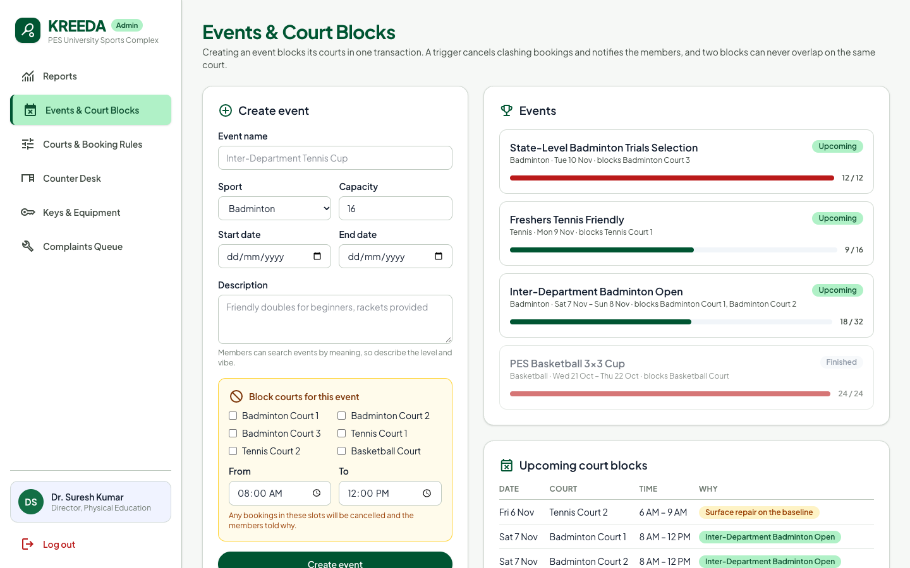

<details>
<summary>More admin pages: Courts & Booking Rules</summary>

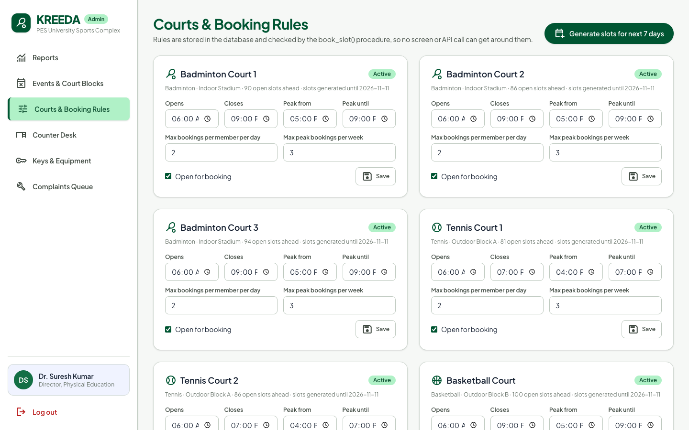

</details>

## Databases (Option 2: SQL + vector database)

| Database | Type | Holds | Why |
|---|---|---|---|
| **PostgreSQL 17** | Relational | Members, courts, slots, bookings, events, equipment, keys, complaints: 17 tables | The data is relational, and booking needs transactions and constraints: only the database can guarantee one slot = one booking under simultaneous requests |
| **Qdrant** | Vector (NoSQL) | Embeddings of game posts, complaints and event descriptions | This text is worded differently every time ("net torn on court 2" vs "badminton net sagging, court two"), so keyword search fails. Qdrant finds matches by meaning |

PostgreSQL is the single source of truth. Each Qdrant point uses the same id as its PostgreSQL row; search returns ids and the details are read from PostgreSQL. The vectors can be rebuilt any time with `npm run index`.

### Why PostgreSQL over MySQL

- **Partial unique index**: `one_active_booking_per_slot ON booking (slot_id) WHERE status <> 'CANCELLED'` stops double booking in one line. MySQL has no partial indexes.
- **Exclusion constraint**: `EXCLUDE USING gist (court_id WITH =, tsrange(...) WITH &&)` makes overlapping court blocks impossible. MySQL has no equivalent.
- `pgcrypto` hashes passwords with bcrypt inside the database.

## Database design

ER diagram: `docs/KREEDA_ER_Chen.drawio` (Chen notation) and `docs/KREEDA_ER.mmd` (crow's foot).

**17 tables:** member, staff, app_user, court, slot, booking, waiting_list, attendance, event, event_registration, court_block, game_post, complaint, locker_key, key_issue, equipment, equipment_issue.

**Advanced features (all in `db/schema.sql`):**

| Feature | Where |
|---|---|
| Transactions and row locking | `book_slot()` locks the member row (`FOR UPDATE`) so fair-use limits hold under concurrent requests; event creation and its court blocks are inserted in one transaction |
| Stored procedures / functions | `book_slot`, `cancel_booking`, `join_waitlist`, `mark_no_shows`, `generate_slots`, `is_peak` |
| Triggers | Slot status sync; **automatic waiting-list promotion** when a booking is cancelled; court blocks cancel clashing bookings with a reason; attendance updates booking status; event capacity check; equipment stock and late fines; key status |
| Constraints | PK/FK, UNIQUE, CHECK (phone format, time ranges, stock between 0 and total), partial unique indexes, an exclusion constraint |
| Views | `v_slot_board`, `v_todays_schedule`, `v_member_stats`, `v_open_complaints`, and 10 report views in `db/reports.sql` |
| Indexes | B-tree, composite, partial, GiST |
| Vector similarity search | Qdrant, cosine similarity |
| DDL | CREATE, ALTER (adds foreign keys; disables a trigger while loading history), DROP |

### Reports (`db/reports.sql`)

Each report is a view, shown as a chart on the admin dashboard:

1. Average bookings per member by department
2. Court utilisation %
3. Peak hours heatmap (weekday × hour)
4. Repeat no-shows (`HAVING`)
5. Average play time per sport
6. Courts with more complaints than average (`HAVING` with a subquery)
7. Event fill rate
8. Equipment issued, overdue and fines
9. Bookings per day
10. KPIs

### Vector search design

| Aspect | Choice |
|---|---|
| What is embedded | Game posts (sport + text + preferred time), complaints (court or item name + text), events (name + sport + description) |
| Model | `all-MiniLM-L6-v2` (384 dimensions), run locally with Transformers.js, so no API key or cost |
| Storage | Qdrant collections `game_posts`, `complaints`, `events`; point id = PostgreSQL primary key |
| Metadata (payload) | game_posts: sport, is_open, member_id · complaints: status, court_id, equipment_id · events: sport, end_date |
| Similarity | Cosine |
| Retrieval | Filter on payload first (same sport, still open, not resolved, not your own post), then top-k by similarity. Complaints at 74%+ similarity are offered as "same problem", and the new report is linked with `duplicate_of` |

## Running it

Requirements: Node.js 20+, PostgreSQL 14+ (with the bundled `pgcrypto` and `btree_gist` extensions), a Qdrant cluster (the free tier at cloud.qdrant.io is enough).

### Step 1: Install PostgreSQL

**macOS (Homebrew):**

```bash
brew install postgresql@17
brew services start postgresql@17
echo 'export PATH="/opt/homebrew/opt/postgresql@17/bin:$PATH"' >> ~/.zshrc && source ~/.zshrc
```

**Windows / Linux:** install PostgreSQL 17 from postgresql.org and make sure `psql` and `createdb` are on your PATH.

### Step 2: Get the code and install packages

```bash
git clone https://github.com/dhanushss05/KREEDA.git
cd KREEDA
npm install
```

### Step 3: Configure `.env`

```bash
cp .env.example .env
```

Open `.env` and fill in:

| Variable | Value |
|---|---|
| `DATABASE_URL` | `postgres://localhost:5432/kreeda` for a local install |
| `SESSION_SECRET` | any long random string |
| `QDRANT_API_ENDPOINT` | your Qdrant cluster URL |
| `QDRANT_API_KEY` | your Qdrant API key |

### Step 4: Create the database and load sample data

```bash
createdb kreeda
npm run db:setup
```

This runs `db/schema.sql` (tables, triggers, functions), `db/seed.sql` (sample members, courts, four weeks of bookings) and `db/reports.sql` (report views).

### Step 5: Build the vector index

```bash
npm run index
```

This embeds game posts, complaints and events and uploads them to Qdrant. The first run downloads the embedding model, so it takes a little longer.

### Step 6: Start the app

```bash
npm run dev
```

Open http://localhost:3000 and sign in with one of the demo logins below.

For a faster, production-style run use `npm run build` and then `npm start`.

The sample data is generated relative to today's date, so the schedule and reports always look current. Run `npm run db:setup` and then `npm run index` to reset everything.

### Demo logins (password `kreeda123`)

| Role | Username |
|---|---|
| Member | `PES1UG24AM083` (or any member SRN) |
| Staff | `STF101` |
| Admin | `ADM001` |

## Demo script

1. **Double booking:** open two terminals with `psql -d kreeda`. In both, run `BEGIN; SELECT book_slot(<member>, <same open slot>);`. The second one waits; `COMMIT` the first and the second fails with `one_active_booking_per_slot`.
2. **Waiting list:** cancel a booking that has people waiting (My Activity → Cancel). The first person in line gets the slot automatically, done by a trigger.
3. **Event blocks:** Admin → Events & Court Blocks → create an event and block courts. The clashing bookings are cancelled and the affected members see a notice in My Activity.
4. **Search by meaning:** Complaints → type "the net on the second badminton court has a hole". The existing torn-net complaint appears as similar. Events → search "beginner, just for fun".
5. **Reports:** Admin → Reports, or run `\i db/reports.sql` in psql to see each query with its output.
6. **All tables:** run `\i db/show_tables.sql` in psql.

## Project structure

```
db/            schema.sql, seed.sql, reports.sql, show_tables.sql
app/           Next.js pages: (member), staff, admin, login; actions/ holds the server actions (backend API layer)
components/    UI components and charts
lib/           PostgreSQL pool, sessions, Qdrant client, embeddings
scripts/       index-qdrant.js rebuilds the vector index from PostgreSQL
docs/          requirements, synopsis, ER diagrams
```

## Security

- Passwords are stored as bcrypt hashes (`crypt()` from `pgcrypto`) and checked inside the database.
- Sessions are HMAC-signed, httpOnly cookies.
- Every page and server action checks the user's role on the server.
- All SQL is parameterised.
- Credentials live only in `.env`, which is git-ignored.
